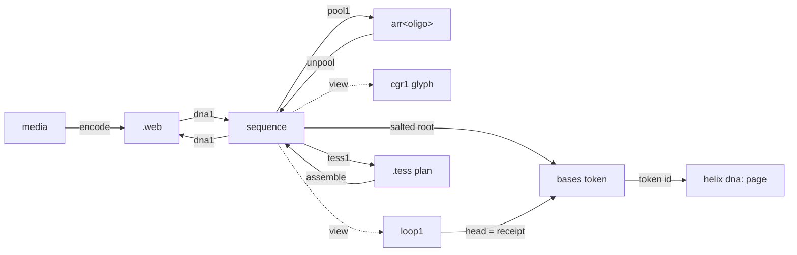

# `organize-stack` — the wetware stack over one primitive

`type: resource.map` · `spec: agent.map` · non-normative; `docs/follow-agent-contract.md` §13 governs on any conflict.

The wetware repositories are layers over a single primitive: a DNA sequence, one ASCII string over `ACGT` ([`dna.md`](../dna.md)). Media becomes a web, a web becomes a sequence, a sequence becomes oligos, pictures and build plans, and a root of that sequence becomes a token and a wiki page. This file maps the layers and names the one value each boundary carries, so an agent can cross a repository boundary without re-deriving anything.

## Specification

```json { type: notebook.cell }
{
  "id": "docs/organize-stack.md",
  "type": "resource.map",
  "role": "place each repository in the stack and name the value crossing each boundary",
  "reads": ["dna.md", "web.json", "docs/follow-agent-contract.md"],
  "writes": [],
  "must": ["one primitive", "one root rule per object", "no layer stores another layer's object", "pin a neighbour, never vendor it"],
  "check": ["S1-S6"]
}
```

## Graph

- ← [follow-agent-contract.md](follow-agent-contract.md)
- → [pin-sources.md](pin-sources.md)
- → [../systems/commit-web.md](../systems/commit-web.md)

## Hierarchy

```text { type: notebook.cell }
wetware-hq
  tesseract   .tess  build plan        parts  ──┐          (compiles a sequence into synthesizable parts)
  web         .web   shallow network     │      │
              .dna   sequence  ◀─────────┘      │          (the primitive; this repository defines it)
                     oligos  arr<oligo>         │          pool1 §10
                     glyph, loop                │          cgr1 §11, loop1 §12
  bases       token  chromosome, ERC-721  ◀─────┘          (chain root + length, the web3 coin)
  helix       page   dna:<token id>                        (the wiki commit; reads the token, never the sequence)
```

| Layer | Repository | Object | Value that crosses the boundary |
|---|---|---|---|
| media | `web` | a uint8 grid (an image) | `sha256` of the source file |
| shallow network | `web` | `.web` weights, 2 hidden layers of sine units | **web root** `sha256(bytes)` (§4) |
| **sequence** | `web` | one `ACGT` record, the primitive | **sequence root** `sha256(ascii(seq))` (§9) |
| oligo pool | `web` | `arr<oligo>`, 117-nt indexed oligos | `sha256` of the pool file, plus the sequence root it rebuilds (§10) |
| glyph | `web` | `cgr1` k-mer picture, text | **counts root** `sha256` of the counts (§11) |
| loop | `web` | `loop1` pseudovisual chain of thought | **head**, the frame hash chain (§12) |
| build plan | `tesseract` | `.tess`, a tree of parts for one target | **plan root** `sha256` of the canonical plan bytes; its target is a sequence root |
| chromosome token | `bases` | one ERC-721, 1 base … n bases | **chain root** `sha256(salt \|\| ascii(seq))` and the length in bases; print `receipt` is a loop head |
| wiki commit | `helix` | page `dna:<token id>`, claims about the chromosome | **locus root**, the fold over the page's claims |

Reading the column: each row's object is named by exactly one value, and that value is what a neighbouring repository stores, pins or commits. A layer that needs a neighbour's object fetches it by that value and checks it; it never recomputes it a second way and never renames it.

## Rules

The normative statement is `docs/follow-agent-contract.md` §13. In short:

- **One primitive (S1).** Anything the stack calls DNA is a sequence as `dna.md` defines it. `dna1`, `pool1` oligos and a `tesseract` target or part are the same object under extra constraints, never a different dialect.
- **One root rule (S2).** A sequence root is `sha256(ascii(seq))`, and a chain root is `sha256(salt || ascii(seq))` with a 32-byte salt. Nothing else hashes a sequence. Bases `root` and helix `sequence-root` are chain roots; a tesseract target and a loop header carry sequence roots. They meet only through a token id, and only a salt holder can show the two roots name one sequence.
- **No crossed names (S3).** A web root, a sequence root, a counts root, a loop head, a plan root and a locus root name different objects. One is never accepted where another is required.
- **Bases stay in sequence files (S4).** The chain stores a root and a length. A helix page stores claims about a chromosome. A glyph, a diff and a loop store counts and hashes. None of them stores a base.
- **Two-way or a view (S5).** `web ↔ dna1` and `sequence ↔ pool1` are exact both ways. `media → web` is a measured approximation, and `sequence → glyph/loop` is a view regenerated on demand. A view is never read back as data: web refuses it by §1, helix by `reverse_flow`.
- **Refuse, never guess (S6).** Every conversion in the stack returns a sequence the data determines, or a stable refusal code.

## Direction



Solid edges carry bases or a commitment to them; dotted edges are views. Up the stack (token, page) only roots travel, so a chromosome can be held, printed and cited by agents that never see its sequence.

## Neighbours

| Repository | What this repository may rely on | How it is held |
|---|---|---|
| [`wetware-hq/bases`](https://github.com/wetware-hq/bases) | the token model: commit-reveal mint, `polymerize` print chain, `tokenURI` to helix | cited; `web.json` `chain` is `null`, so nothing is committed |
| [`wetware-hq/helix`](https://github.com/wetware-hq/helix) | `dna:` pages, the `printed` and `glyph` predicates | cited; helix pins web, not the other way round |
| [`wetware-hq/tesseract`](https://github.com/wetware-hq/tesseract) | compiling a sequence into synthesizable parts | cited; tesseract pins web by commit |

A neighbour is pinned and cited, never vendored (`docs/pin-sources.md`). web is the lowest layer that holds a sequence, so it depends on no neighbour at run time: the rows above are what the other layers rely on here.

## Falsification

- Two files in the stack hash one sequence two different ways.
- A token, a page, a glyph or a loop is found holding bases.
- A value named as one root is accepted where another root is required.
- `python ref/dna.py decipher samples/astronaut-64.fa out.web` does not reproduce `samples/astronaut-64.web`.

## Licence

MIT, see `LICENSE`. Neighbouring repositories are cited and pinned, not vendored.
