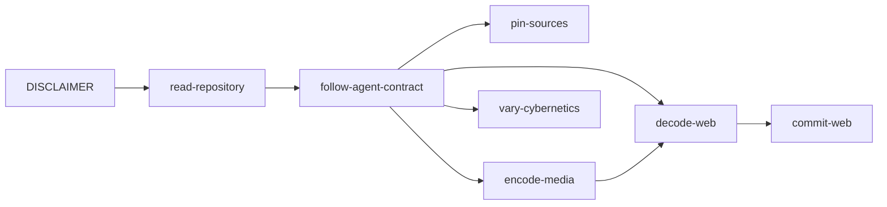

# `read-repository` — route an agent

`type: resource.router` · `spec: agent.router` · non-normative; `docs/follow-agent-contract.md` governs on any conflict.

web stores static media as a shallow neural network: the weights of a 2-hidden-layer sine network that maps a position to the value there. It is a specbase with one reference implementation, `ref/web.py` (Python and numpy).

## Specification

```json { type: notebook.cell }
{
  "id": "docs/read-repository.md",
  "type": "resource.router",
  "role": "send each task down the smallest sufficient path",
  "reads": ["DISCLAIMER", "task"],
  "writes": [],
  "must": ["read DISCLAIMER first", "stop at the first sufficient row"],
  "check": ["route row exists", "Graph reciprocity"]
}
```

## Graph

- → [follow-agent-contract.md](follow-agent-contract.md)

## Route

Read `DISCLAIMER` before any node. Then take the first row that covers the task and stop.

| Task | Path |
|---|---|
| Know what a `.web` file is | `web.md` |
| Turn an image into a web | contract → `skills/encode-media.md` |
| Turn a web back into an image | contract §3 → `skills/decode-web.md` |
| Check a web file or its claimed fidelity | contract §5–§7 → `skills/decode-web.md` §Check |
| Put a web on chain, or read one back | `systems/commit-web.md` |
| Check whether a source or sample may be used | `docs/pin-sources.md` |
| Understand the link to biological neurons | `docs/vary-cybernetics.md` |
| Traverse without reading prose | `ooc/web.og` |
| Anything else, or a conflict | `docs/follow-agent-contract.md` |

## Reading order



## Licence

MIT, see `LICENSE`. Sources are cited and pinned, not vendored.
